# Frontend Architecture — Beverage Ordering Website

> Audience: developers (new members) and AI coding assistants.
> Companion docs: `fe-project-rules.md` (coding rules) · `../../docs/api-spec.md` (API contract) · `../../be/docs/be-architecture.md` (backend flows).
> This doc explains **how the pieces fit together and why**. Rules, folder anatomy, and endpoint details are not repeated here; follow the section references.

---

## 1. Goals & Constraints

- **Goal:** a fast, mobile-friendly ordering experience (browse -> customize -> cart -> checkout -> track) and an admin console, maintainable by a 10-person team alongside the backend.
- **Constraints:** React 19 + Vite + TypeScript SPA, feature-based organization mirroring the backend, **one SPA for customers and admins**, the backend is the single source of truth.
- **Non-goals (for now):** SSR/SEO-driven rendering, native apps, offline ordering, guest checkout (the API requires login for the cart), i18n beyond locale-aware formatting.

### Quality targets (adjust to real needs)

| Attribute | Target |
|---|---|
| Performance | Menu usable < 2.5 s LCP on mid-range mobile over 4G; customer entry JS budget ~200 KB gzip (admin excluded) |
| Correctness | Prices/totals/availability/status always come from the API, never computed authoritatively on the client |
| Resilience | Every screen has loading / error / empty states; expired sessions recover silently |
| Security | No secrets in the bundle; tokens never logged; no `dangerouslySetInnerHTML` with API content |
| Maintainability | New feature added without touching other features' internals |

---

## 2. System Context

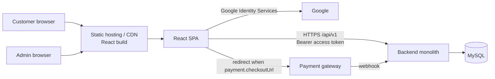

- The SPA talks **only** to the backend API (plus Google's sign-in script and gateway redirects).
- Customers and admins load the same `index.html`; the role decides which routes and lazy chunks they can reach.
- The backend authorizes everything. The SPA's role-based hiding is UX only.

---

## 3. Logical Architecture

### 3.1 Module layout

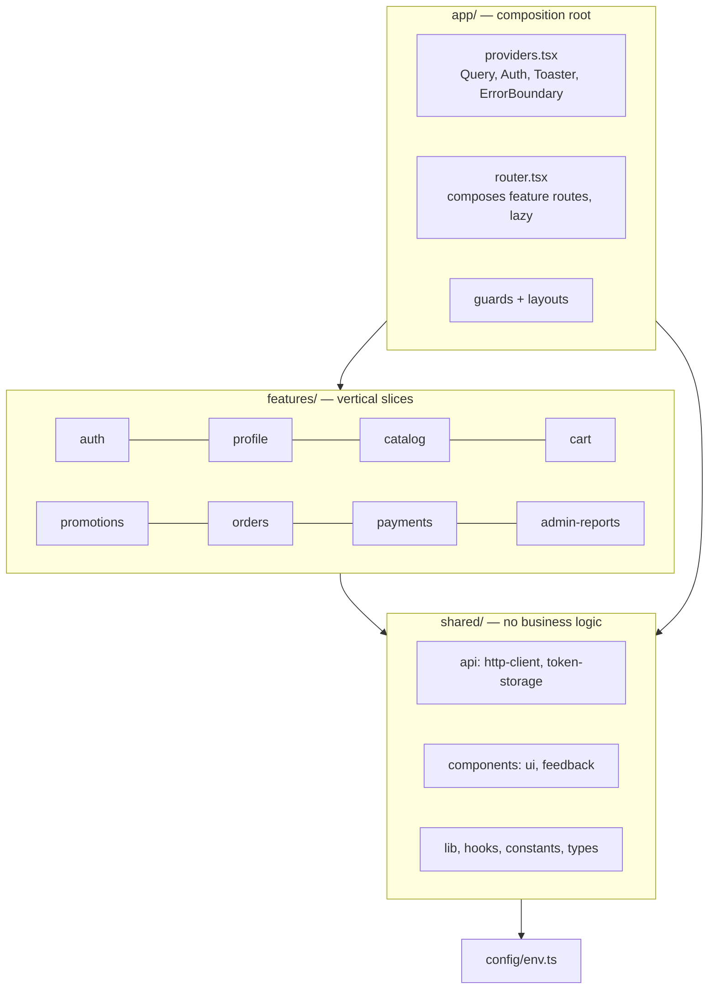

- `app/` is the only layer that knows every feature. `shared/` never imports `features/` or `app/`.
- Each feature is a vertical slice: `api -> hooks -> components -> pages`, plus types, schemas, and routes.

### 3.2 Feature responsibilities

| Feature | UI responsibility | Main API groups (see `api-spec.md`) |
|---|---|---|
| `auth` | Login, register, Google sign-in, session, admin user management | `/auth/*`, `/admin/users` |
| `profile` | Profile, addresses | `/profile`, `/profile/addresses` |
| `catalog` | Menu, product detail + customization, admin products/categories/options | `/categories`, `/products`, `/admin/products...` |
| `cart` | Cart page, mini-cart badge, cart mutations | `/cart`, `/cart/items` |
| `promotions` | Voucher input/preview, admin vouchers | `/vouchers/validate`, `/admin/vouchers` |
| `orders` | Checkout, my orders, tracking, admin order board | `/orders`, `/admin/orders` |
| `payments` | Payment method selection, admin refund | `payment` in order DTO, `/admin/payments/:id/refund` |
| `admin-reports` | Sales and top-products dashboards | `/admin/reports/*` |

- Admin screens live **inside the feature they manage** (`pages/admin/`), loaded lazily under `AdminLayout`.
- Constraint: a feature's `index.ts` must **not** statically import admin pages; routes reach them through `lazy()`, otherwise admin code leaks into the customer bundle.

### 3.3 Dependency graph (allowed direction)

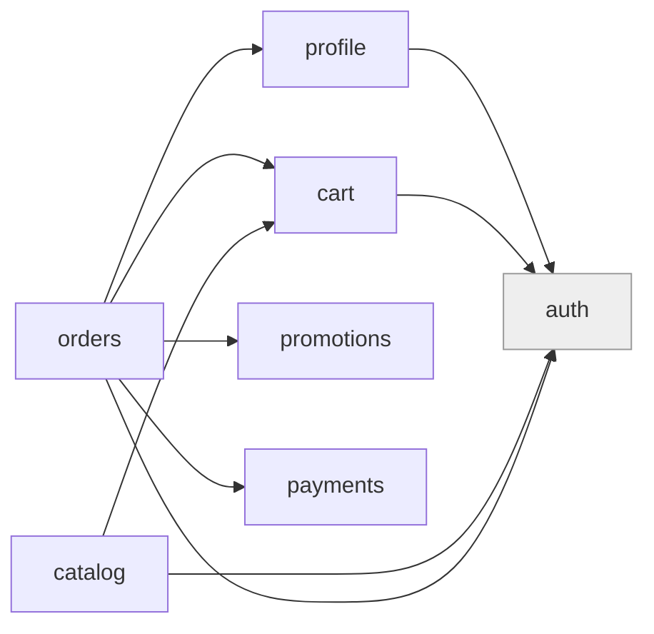

- `auth` is foundational (`useAuth()` / `useCurrentUser()`), so any feature may use it. `promotions`, `payments`, `admin-reports` depend only on `shared`.
- `cart` does **not** import `catalog`: cart DTOs already carry the product info they need.
- `catalog` imports `cart` because the product page triggers `useAddToCart()`.
- Cross-feature imports go through `@/features/<name>` only (ESLint-enforced). No cycles.
- Where the backend uses events (`payments` -> `orders`), the frontend needs none: the SPA learns about payment results by **polling the order** (see §5.4).

---

## 4. Runtime Architecture

### 4.1 Rendering and bootstrap

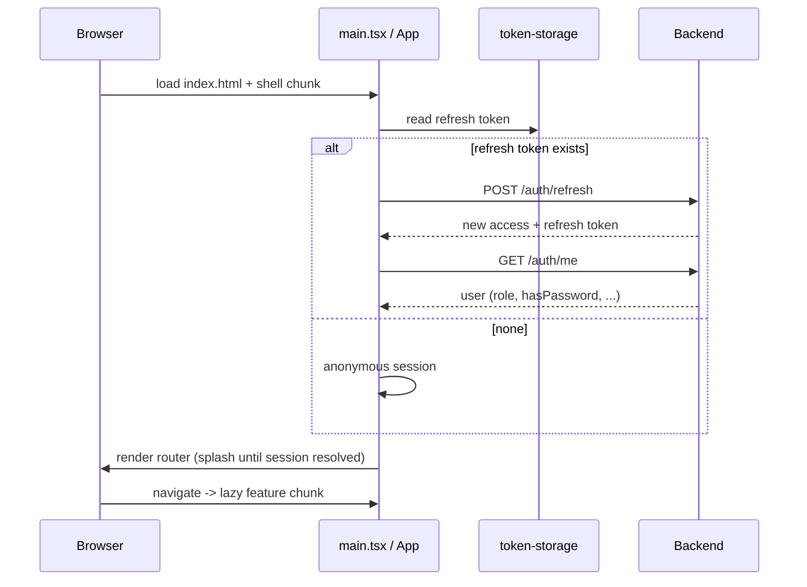

- Splash is shown only until the session is resolved; public pages (menu) then render for everyone.
- Tokens: access token **in memory**; refresh token in `localStorage`, both only via `token-storage.ts`.

### 4.2 Layered call path inside a feature

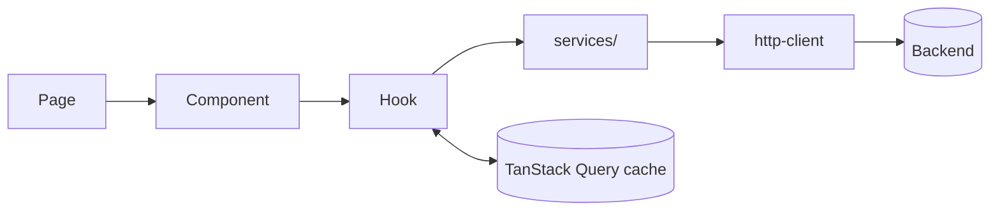

- Pages/components never call `services/` or `fetch`; hooks are the only bridge.
- `http-client` unwraps the success envelope and throws `ApiError` for the error envelope.

### 4.3 State architecture

| State | Home | Why |
|---|---|---|
| Server data (menu, cart, orders, profile) | TanStack Query cache | One cache, automatic refetch/invalidation |
| Session user | `AuthProvider` + `['auth','me']` query | Derived from server |
| Form state | React Hook Form | Local to the form |
| Filters / pagination / sort | URL search params | Shareable, back-button friendly |
| Local UI (modal, tabs) | `useState` | Short-lived |
| Cross-page UI (cart drawer) | Small context/Zustand, never server data | Rare |

- The **cart is server state** (one cart per user on the backend); no local cart copy.
- Freshness policy (`staleTime`): categories/products 5 min, product detail 1 min, reports 1 min, cart/orders/admin lists 0.

---

## 5. Key Flows

### 5.1 Authenticated request with single-flight token refresh

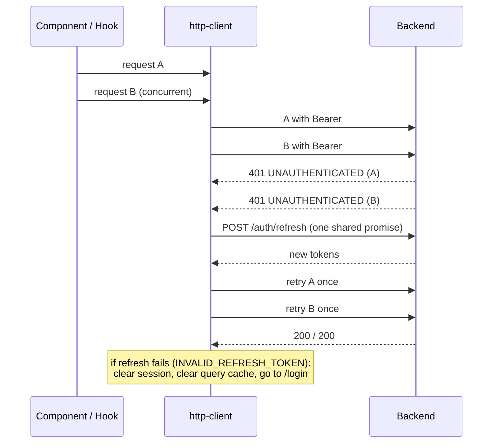

- Mutations such as `POST /orders` and `POST /cart/items` are **never auto-retried** on failure (only the one post-refresh replay of the original request).

### 5.2 Google login

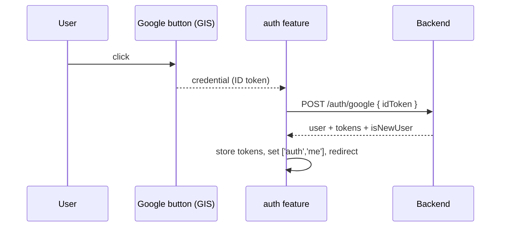

- The ID token is forwarded untouched; the SPA never decodes or trusts it.
- `hasPassword=false` accounts: hide password-change UI; `USE_GOOGLE_SIGN_IN` on password login shows "Please continue with Google". "Unlink Google" appears only when `hasPassword=true`.

### 5.3 Add to cart and checkout

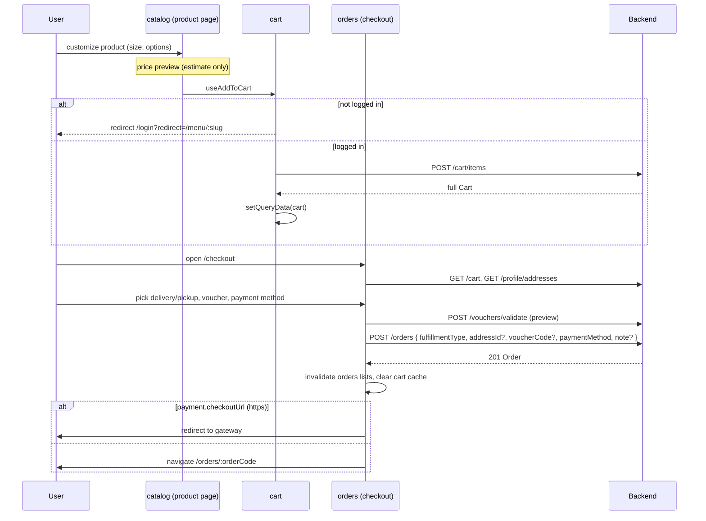

- The checkout request carries **no items or prices**; the server builds the order from the cart.
- On `CART_EMPTY` / `PRODUCT_UNAVAILABLE`: refetch cart, show a message, go back to the cart. Cart lines with `isAvailable=false` block checkout in the UI.
- Double submit: the button is disabled while pending; the backend also protects (second request gets `CART_EMPTY`).

### 5.4 Order tracking and payment result (polling)

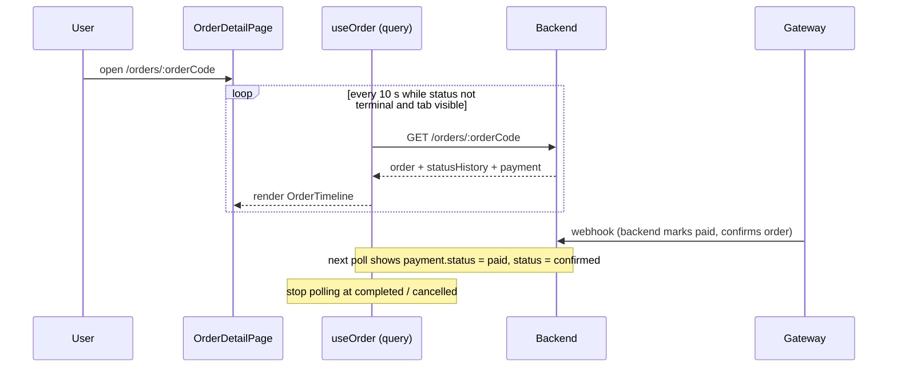

- The SPA never receives payment webhooks; it **observes** the result through the order. The gateway return URL points to `/orders/:orderCode` (no separate payment-result route is required).
- Admin order board polls the list every 15 s.
- **Cancel button display:** The cancel order button is displayed to customers **only** when the status is `pending` or `confirmed`. Once status becomes `preparing` or `ready`, the button is hidden/disabled (as the kitchen has begun preparation).

### 5.5 Admin processes an order

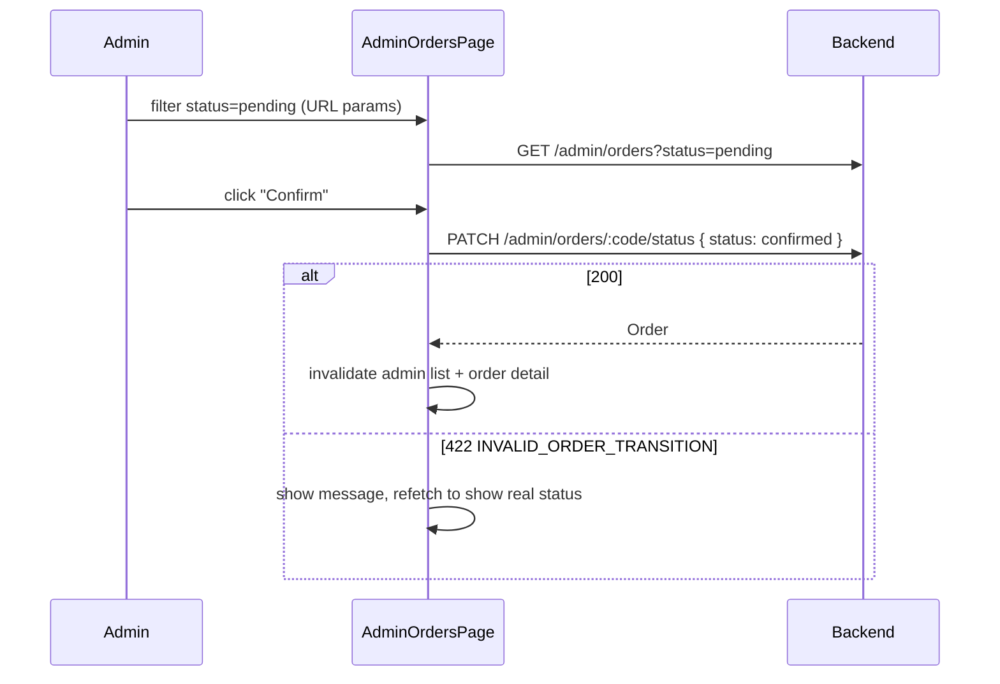

- Buttons show only valid next steps (a client hint mirroring the backend status machine; `delivering` is skipped for `pickup`). The backend stays authoritative.

---

## 6. Routing Architecture

- Each feature exports route objects (`<feature>.routes.tsx`, customer + admin arrays) using route-level `lazy`; `app/router.tsx` composes them under layouts.
- Layouts: `CustomerLayout` (menu, cart badge), `AuthLayout` (login/register), `AdminLayout` (admin nav).
- Guards: `RequireAuth` -> `/login?redirect=<path>`; `RequireRole(['staff', 'admin'])` for staff operational boards, `RequireRole('admin')` -> 403 page. Mirrors backend RBAC permissions.
- Chunking model:

| Chunk | Loaded by | Contains |
|---|---|---|
| Shell | everyone | app, providers, router, shared, `auth` basics |
| Customer features | on navigation | menu, product, cart, checkout, orders, profile |
| Admin | admin users only | all `pages/admin/*`, `admin-reports` (+ charts library) |

- Path constants live in `shared/constants/routes.ts`; no hardcoded paths.

---

## 7. API Integration Architecture

- **Contract-first:** `../../docs/api-spec.md` is the contract; DTO types in each feature's `*.types.ts` mirror it.
- **Conventions handled centrally** in `http-client` (Axios instance with interceptors): base URL from env, JSON headers, Bearer header, envelope unwrapping, `ApiError(status, code, message, details)`.
- **Error pipeline:**

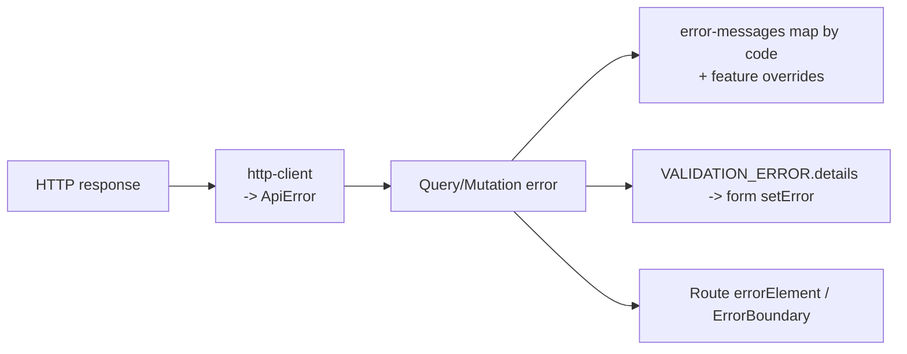

- Messages are chosen by **error code**, never raw server text for unknown codes.
- Retry policy: queries retry up to 2 times on network/`5xx`, never on `4xx`; mutations are not retried.

### Money, dates, and display data

- Money is a JSON `number`; one `formatMoney` helper (Intl, currency/locale from env). Dates arrive as UTC ISO and are formatted in the user's locale.
- The only client-side price calculation is the **product price preview** (`calcPricePreview` in `catalog`), labeled as an estimate. Cart, checkout, and order screens show server totals as returned.
- Order status labels/colors come from one map (`shared/constants/order-status.ts`).

---

## 8. Cross-Cutting Concerns

| Concern | Approach |
|---|---|
| Authentication | In-memory access token, `localStorage` refresh token via `token-storage.ts`, single-flight refresh |
| Authorization (UI) | `RequireAuth` / `RequireRole` (customer, staff, admin); UX only, backend enforces |
| Error handling | `ApiError` -> code-based messages -> form errors / route error elements / global `ErrorBoundary` |
| Loading/empty/error | Every page renders four states via `shared/components/feedback` |
| Configuration | `config/env.ts` (Zod-validated `VITE_API_BASE_URL`, `VITE_GOOGLE_CLIENT_ID`, `VITE_CURRENCY`, `VITE_LOCALE`) |
| Accessibility | Semantic HTML, labelled inputs, focus visibility, `aria-live` for toasts and order-status changes |
| Styling | Tailwind with shared design tokens; mobile-first, admin usable at tablet width |
| Logging | No tokens/payloads in logs; unexpected errors reported through the global boundary |
| Testing | Vitest + RTL + MSW per feature; Playwright for critical journeys |

---

## 9. Build, Deployment & Environments

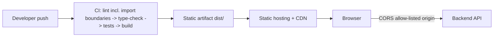

- Output is a **static bundle** (HTML/JS/CSS/assets) served from a CDN; no Node runtime in production.
- `VITE_*` values are baked in at build time, so build **once per environment** (`staging`, `production`) with that environment's `.env`.
- Hosting rules: SPA fallback to `index.html` for client routes; hashed assets cached as immutable; `index.html` not cached long-term.
- Backend CORS must allow the frontend origin (see `../../be/docs/be-architecture.md` §7); alternatively serve both behind one origin and proxy `/api`.
- Security headers/CSP set at the host: allow only the API origin, Google Identity Services, and the image CDN.
- Assumptions (confirm with the team): separate frontend origin on a CDN; product images served from `imageUrl` on a CDN.

---

## 10. Performance Architecture

- **Code splitting** per route/feature; admin and chart libraries only in the admin chunk.
- **Cache strategy** via TanStack Query `staleTime` (see §4.3); `keepPreviousData` for paginated lists; debounced search (300 ms).
- **Polling discipline:** only for active orders, paused in background tabs, stopped on terminal status.
- **Images:** lazy-loaded with explicit dimensions; responsive sizes.
- **Lists:** server-side pagination everywhere; never fetch "all products" or "all orders" client-side.
- Memoization only after profiling shows a need.

---

## 11. Security Architecture

- **Token model:** access token in memory (lost on reload, restored by refresh), refresh token in `localStorage`. This is exposed to XSS, so XSS prevention is the main control: no `dangerouslySetInnerHTML` with API content, strict CSP, dependency hygiene.
- Tokens are accessed **only** through `token-storage.ts`; never logged or placed in URLs.
- The Google ID token is passed straight to the backend; Google access tokens are never used.
- All `VITE_*` values are public; no secrets in the bundle.
- Admin UI hiding is cosmetic. Every sensitive action is authorized by the backend (`403` is handled gracefully).
- Logout clears tokens **and** the entire query cache so the next user never sees prior data.
- Future hardening: move the refresh token to an `httpOnly` cookie (requires a backend change).

---

## 12. Scalability & Evolution Path

Start simple; evolve when real needs appear.

1. **Now:** single SPA, feature slices, TanStack Query cache, polling for tracking.
2. **Typed contract:** generate API types from OpenAPI (derived from backend Zod) and validate drift in CI.
3. **Realtime:** replace polling with SSE/WebSocket for order status when the backend adds it (`../../be/docs/be-architecture.md` §9); the hook `useOrder` keeps the same interface, so pages do not change.
4. **Session hardening:** `httpOnly` cookie refresh flow.
5. **Guest browsing -> guest cart:** needs a backend change (cart is login-only today).
6. **i18n:** introduce a translation layer when a second language is required (currently only locale-aware formatting).
7. **Split admin into its own app** (same repo/workspace, shared `shared/` package) if bundle size or security policy demands it. Feature slices and `pages/admin/` isolation make this a move, not a rewrite.
8. **Team scaling:** assign feature ownership per team; import-boundary lint and the dependency map prevent hidden coupling.

### Known risks

| Risk | Mitigation |
|---|---|
| Hidden coupling between features | ESLint import boundaries, dependency map review in PRs |
| Admin code leaking into the customer bundle | Lazy routes only; `index.ts` never imports admin pages; bundle-size check in CI |
| Token theft via XSS (`localStorage` refresh token) | Strict CSP, no HTML injection, plan for `httpOnly` cookie |
| Stale UI vs fast-changing data (availability, status) | `staleTime: 0` for cart/orders, polling for active orders, handle `422` by refetch |
| Client/server rule drift (validation, status transitions, price preview) | Rules centralized (`schemas`, status map, `calcPricePreview`), contract tests/MSW from `../../docs/api-spec.md`, backend remains authoritative |
| Polling load as order volume grows | Interval discipline, stop on terminal status, move to SSE |
| DTO drift from the API | OpenAPI-generated types; MSW handlers updated with the spec |

---

## 13. Architecture Decision Records (summary)

| # | Decision | Why | Trade-off |
|---|---|---|---|
| 1 | Feature-based vertical slices mirroring backend | Matches team ownership, easy navigation | Needs discipline on boundaries |
| 2 | One SPA for customers and admins | One codebase, shared UI/auth | Admin code must be lazily isolated |
| 3 | Admin pages inside their owning feature (`pages/admin/`) | Admin and customer views share types/hooks | Risk of bundle leakage; guarded by lazy routes |
| 4 | TanStack Query for all server state | Caching, invalidation, polling built in | Learning curve; discipline to avoid duplicating state |
| 5 | Cart is server state only | Backend owns the cart; no sync bugs | Login required to add to cart |
| 6 | URL as the state for filters/pagination | Shareable, back-button friendly | More param plumbing |
| 7 | Polling for order tracking and payment result | Simple, no realtime infra needed | Latency up to the interval; upgrade path to SSE |
| 8 | Access token in memory, refresh token in `localStorage` | Matches current API (tokens in body) | XSS exposure; cookie flow planned |
| 9 | No client-authoritative money logic (preview only) | Prevents price tampering and drift | Preview may differ slightly from the server |
| 10 | Route-level lazy loading, admin as separate chunk | Fast customer entry | Extra loading states on navigation |
| 11 | Static build deployed to CDN, env baked at build time | Simple, cheap, cacheable | One build per environment |
| 12 | RBAC role model mirrored from the backend | Staff and Admin access operational features; admin passes all guards | Fine-tuned route guarding; extend as roles grow |

---

## 14. Key Decisions & Agreements

- **Payment return URL:** Gateway returns users directly to `/orders/:orderCode` (no separate payment-result route; order detail polling displays payment status).
- **Customer Cancellation:** Customers may only cancel during `pending` and `confirmed`. Once `preparing` begins, only staff and admin can cancel.
- **Refresh token storage:** `localStorage` for now with single-flight refresh; planned move to `httpOnly` cookie later.
- **Hosting topology:** Separate frontend origin on CDN with backend CORS allow-list.
- **Realtime tracking:** Polling (~10 s) for active orders at launch; path to SSE defined.

---

## 15. Where to Look (quick index)

- Coding rules, folder anatomy, naming, Do/Don't -> `fe-project-rules.md`
- Endpoints, schemas, error codes -> `../../docs/api-spec.md`
- Backend flows (checkout, payment webhook, order lifecycle) -> `../../be/docs/be-architecture.md`
- Adding a feature -> `fe-project-rules.md` §17
- Changing a flow in §5 -> update the diagram here in the same PR
